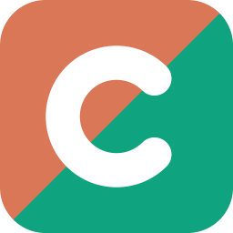

<div align="center">



<h1>ChatLocal</h1>

<p><b>Ton assistant IA de bureau : rapide, élégant et privé.</b><br>
Discute avec tes modèles locaux <a href="https://ollama.com">Ollama</a> ou avec les modèles NVIDIA, dans une interface sombre soignée.</p>

<p>
  
  
  
  
</p>

<p>
  <a href="https://github.com/alexmrgy/ChatLocal/raw/main/download/ChatLocal.exe">
    
  </a>
</p>

<p>
  <a href="#-aperçu">Aperçu</a> ·
  <a href="#-fonctionnalités">Fonctionnalités</a> ·
  <a href="#-installation">Installation</a> ·
  <a href="#️-raccourcis">Raccourcis</a> ·
  <a href="#️-structure">Structure</a>
</p>


</div>

<br>

## 🎯 Aperçu

ChatLocal est une application de bureau pour discuter avec une IA **sans passer par un site web**.
Tes conversations sont enregistrées sur ton PC, rangées dans des dossiers, et tu peux écrire, éditer et même
**exécuter le code** que l'IA te propose, sans quitter la fenêtre.

## ✨ Fonctionnalités

| | |
|---|---|
| 🤖 **100 % local** | Utilise tes modèles Ollama : rien ne quitte ton ordinateur. |
| ☁️ **Modèles NVIDIA** | Ajoute ta clé API pour utiliser les modèles hébergés. La clé est chiffrée sur disque (DPAPI Windows). |
| 🗂️ **Historique organisé** | Dossiers, épinglage, archivage, renommage, déplacement et recherche rapide. Sélection multiple (`Ctrl` + clic, `Maj` + clic) pour archiver ou supprimer plusieurs discussions d'un coup. |
| 📎 **Fichiers joints** | Bouton `+` ou glisser-déposer : fichiers texte et code (lus par le modèle) et images (modèles Ollama avec vision). |
| ⚖️ **Comparaison de modèles** | Suis une vraie conversation avec deux modèles à la fois : réponses côte à côte, chacun se souvient de ses propres réponses, avec temps de réponse et longueur (`Ctrl+Maj+M`). Les comparaisons sont enregistrées dans l'historique et se rouvrent comme une conversation. |
| 🇫🇷 **Réponses en français** | Tous les modèles répondent toujours en français, avec des emojis adaptés au sujet. |
| 🕐 **Heure du PC** | Tous les modèles connaissent la date et l'heure de ton ordinateur et peuvent te les donner si tu les demandes. |
| 🕶️ **Chat éphémère** | Une conversation qui n'est jamais enregistrée. |
| 🧑‍💻 **Panneau de code** | Les longs blocs de code s'ouvrent à droite, dans un éditeur avec numéros de ligne et coloration. |
| ▶️ **Terminal intégré** | Lance du code Python ou C directement depuis la réponse. |
| ✏️ **Édition et versions** | Modifie un message et retrouve les différentes versions d'une réponse. |
| 📝 **Markdown complet** | Titres, listes, tableaux, citation d'un passage, copie de la dernière réponse. |
| 🎨 **Thème sombre** | Interface épurée avec la police Nunito, fournie avec l'application. |

## 🚀 Installation

### ⬇️ Le plus simple : télécharger l'application

1. **[Télécharge ChatLocal](https://github.com/alexmrgy/ChatLocal/raw/main/download/ChatLocal.exe)** (environ 40 Mo).
2. Double-clique dessus : rien à installer.
3. Installe [Ollama](https://ollama.com) si ce n'est pas déjà fait, puis `ollama pull gemma3` pour avoir un modèle.

> ⚠️ **Windows bloque le fichier ?** L'application n'est pas signée, donc Windows peut afficher
> « Une stratégie de contrôle d'application a bloqué ce fichier » ou « Windows a protégé votre ordinateur ».
> Deux solutions :
> - **Débloquer le fichier** : clic droit sur le fichier **ChatLocal** téléchargé → **Propriétés** → coche **Débloquer** en bas → **OK**
>   (ou **Informations complémentaires** → **Exécuter quand même** pour SmartScreen).
> - **Sans exécutable** : installe Python, puis lance `ChatLocal.pyw` (double-clic), voir la section ci-dessous.

### 🧑‍💻 Depuis le code source

**Prérequis :** Windows, Python 3.10+ et [Ollama](https://ollama.com) avec au moins un modèle installé.

```powershell
git clone https://github.com/alexmrgy/ChatLocal.git
cd ChatLocal
pip install -r requirements.txt
ollama pull gemma3
python main.py
```

Tu peux aussi double-cliquer sur `ChatLocal.pyw` : même application, sans fenêtre de console.

> 💡 `gemma3` n'est qu'un exemple : n'importe quel modèle Ollama fonctionne.

### 📦 Créer l'application Windows

Un seul fichier ChatLocal, sans console et avec son icône, à lancer par double-clic :

```powershell
pip install pyinstaller
python scripts/build_exe.py
```

Le résultat se trouve dans le dossier `dist/` (environ 40 Mo) et une copie dans `download/`, utilisée par le bouton de téléchargement. Ollama doit toujours être installé séparément,
et Python doit être installé si tu veux lancer du code Python depuis le terminal intégré.

## ⌨️ Raccourcis

<details open>
<summary><b>Voir tous les raccourcis</b></summary>

<br>

| Raccourci | Action |
|---|---|
| `Ctrl` + `N` | Nouvelle conversation |
| `Ctrl` + `Maj` + `N` | Chat éphémère |
| `Ctrl` + `K` / `Ctrl` + `F` | Rechercher |
| `Ctrl` + `B` | Afficher / masquer l'historique |
| `Ctrl` + `Maj` + `L` | Toutes les discussions |
| `Ctrl` + `Maj` + `M` | Comparer deux modèles |
| `F2` | Renommer la conversation |
| `Ctrl` + `Alt` + `P` | Épingler / désépingler |
| `Ctrl` + `Maj` + `A` | Archiver |
| `Ctrl` + `Maj` + `C` | Copier la dernière réponse |
| `F5` | Actualiser les modèles |
| `F11` | Plein écran |
| `Échap` | Arrêter la génération |

</details>

## 🗃️ Structure

```text
ChatLocal/
├── main.py            point d'entrée
├── ChatLocal.pyw      lanceur par double-clic (sans console, sans application à télécharger)
├── attachments.py     lecture et limites des fichiers joints
├── system_prompt.py   consignes envoyées aux modèles (français, emojis, heure du PC)
├── ui/                interface PySide6 (fenêtre, chat, sidebar, éditeur, terminal…)
├── ollama/            client HTTP Ollama et threads de génération
├── nvidia/            client de l'API NVIDIA
├── database/          base SQLite et chiffrement des clés
├── styles/            thème sombre (dark.qss)
├── assets/            polices et icônes SVG
├── scripts/           icônes, application Windows et capture d'écran
├── download/          ChatLocal (application prête à l'emploi)
├── tests/             tests automatiques
└── docs/              images du README
```

## ⚙️ Configuration

| Variable d'environnement | Rôle | Valeur par défaut |
|---|---|---|
| `OLLAMA_HOST` | Adresse du serveur Ollama | `http://localhost:11434` |
| `NVIDIA_BASE_URL` | Adresse de l'API NVIDIA | `https://integrate.api.nvidia.com/v1` |
| `CHATLOCAL_DATA_DIR` | Dossier des données | `%APPDATA%\ChatLocal` |

## 🧪 Tests

Chaque fichier de `tests/` est un script indépendant, à lancer depuis la racine du projet :

```powershell
python tests/db_test.py
python tests/render_test.py
```

Certains tests demandent qu'Ollama soit lancé avec un modèle installé.

## 🔒 Confidentialité

Les conversations sont stockées dans une base SQLite locale. Avec Ollama, **aucune donnée ne quitte ta machine**.
Seuls les modèles NVIDIA envoient tes messages à l'API NVIDIA.

## 🛠️ Technologies

[Python](https://www.python.org) · [PySide6 / Qt](https://doc.qt.io/qtforpython-6/) · [Ollama](https://ollama.com) · SQLite · [Pygments](https://pygments.org) · [Markdown](https://python-markdown.github.io)

## 📄 Licence

La police Nunito est sous licence OFL (voir `assets/fonts/OFL-Nunito.txt`).

<div align="center">
<br>
<sub>Fait avec ❤️ en Python</sub>
</div>
