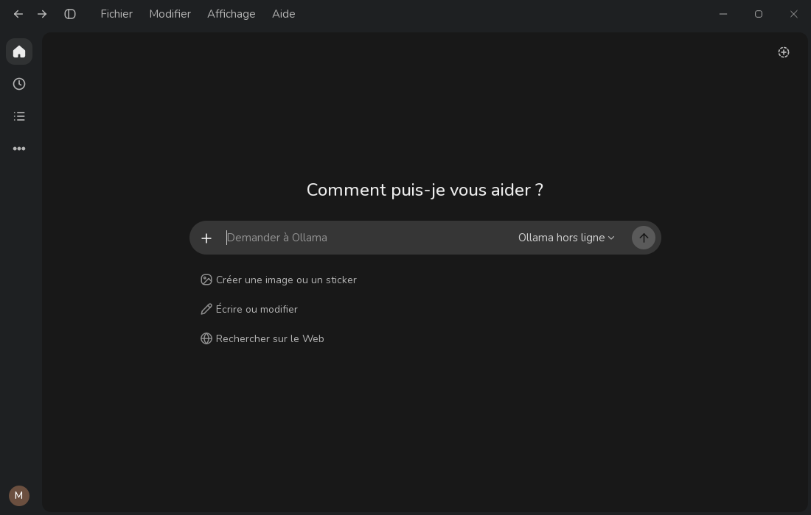

<div align="center">

# 💬 ChatLocal

**Un client de chat IA de bureau, rapide et privé, pour tes modèles locaux (Ollama) et les modèles NVIDIA.**


-41CD52?logo=qt&logoColor=white)




</div>

---

## ✨ Fonctionnalités

- 🤖 **Modèles locaux avec Ollama**: tes conversations restent sur ton PC, rien n'est envoyé ailleurs.
- ☁️ **Modèles NVIDIA**: ajoute ta clé API pour utiliser les modèles hébergés. La clé est chiffrée sur disque (DPAPI Windows).
- 🗂️ **Historique organisé**: dossiers, épinglage, archivage, renommage, déplacement et recherche rapide (`Ctrl+K`).
- 🕶️ **Chat éphémère**: une conversation qui n'est jamais enregistrée (`Ctrl+Maj+N`).
- 🧑‍💻 **Panneau de code**: les longs blocs de code s'ouvrent sur la droite, dans un éditeur avec numéros de ligne et coloration syntaxique.
- ▶️ **Terminal intégré**: lance du code Python ou C directement depuis la réponse.
- ✏️ **Édition et versions**: modifie un message, compare les différentes versions d'une réponse.
- 📝 **Rendu Markdown** complet, citation d'un passage, copie de la dernière réponse.
- 🎨 **Interface sombre** soignée, police Nunito fournie avec l'application.

## 🚀 Installation

**Prérequis**: Windows, Python 3.10+ et [Ollama](https://ollama.com) installé avec au moins un modèle.

```powershell
git clone https://github.com/alexmrgy/ChatLocal.git
cd ChatLocal
pip install -r requirements.txt
ollama pull gemma3        # ou n'importe quel autre modèle
python main.py
```

## ⌨️ Raccourcis

| Raccourci | Action |
|---|---|
| `Ctrl+N` | Nouvelle conversation |
| `Ctrl+Maj+N` | Chat éphémère |
| `Ctrl+K` / `Ctrl+F` | Rechercher |
| `Ctrl+B` | Afficher / masquer l'historique |
| `Ctrl+Maj+L` | Toutes les discussions |
| `F2` | Renommer la conversation |
| `Ctrl+Alt+P` | Épingler / désépingler |
| `Ctrl+Maj+A` | Archiver |
| `Ctrl+Maj+C` | Copier la dernière réponse |
| `F5` | Actualiser les modèles |
| `F11` | Plein écran |
| `Échap` | Arrêter la génération |

## 🗃️ Structure du projet

```
ChatLocal/
├── main.py              # point d'entrée
├── requirements.txt
├── ui/                  # interface PySide6 (fenêtre, chat, sidebar, éditeur de code, terminal…)
├── ollama/              # client HTTP Ollama + threads de génération
├── nvidia/              # client de l'API NVIDIA
├── database/            # base SQLite + chiffrement des clés (DPAPI)
├── styles/              # thème sombre (dark.qss)
├── assets/              # polices et icônes SVG
├── scripts/             # génération des icônes (generate_icons.py)
├── tests/               # tests et captures automatiques
└── docs/                # images du README
```

## ⚙️ Configuration

| Variable d'environnement | Rôle | Défaut |
|---|---|---|
| `OLLAMA_HOST` | Adresse du serveur Ollama | `http://localhost:11434` |
| `NVIDIA_BASE_URL` | Adresse de l'API NVIDIA | `https://integrate.api.nvidia.com/v1` |
| `CHATLOCAL_DATA_DIR` | Dossier des données (base SQLite) | `%APPDATA%\ChatLocal` |

## 🧪 Tests

Chaque fichier de `tests/` est un script indépendant, lancé depuis la racine du projet :

```powershell
python tests/db_test.py
python tests/render_test.py
python tests/smoke_test.py
```

Certains tests ont besoin d'Ollama lancé avec un modèle installé.

## 🔒 Confidentialité

Les conversations sont stockées localement dans une base SQLite. Avec Ollama, aucune donnée ne quitte ta machine. Seule l'utilisation des modèles NVIDIA envoie tes messages à l'API NVIDIA.

## 🛠️ Technologies

[Python](https://www.python.org) · [PySide6 / Qt](https://doc.qt.io/qtforpython-6/) · [Ollama](https://ollama.com) · SQLite · [Pygments](https://pygments.org) · [Markdown](https://python-markdown.github.io)

## 📄 Licence

Police Nunito sous licence OFL (voir `assets/fonts/OFL-Nunito.txt`). Ajoute ici la licence de ton projet (par exemple MIT).
